<div align="center">

# AutoDrive

### Single-camera perception and steering research

**Object detection · Lane instance segmentation · Steering-angle estimation**

[Research paper](output/pdf/AutoDrive_Research_Paper_Reference_Style.pdf) · [Presentation PDF](output/presentation/AutoDrive_Final_Presentation_Ready.pdf) · [PowerPoint with demo video](output/presentation/AutoDrive_Final_Presentation_With_Smooth_Video.pptx) · [Detailed results](docs/RESEARCH_RESULTS.md) · [GitHub](https://github.com/HA2345567/Autodrive)

</div>

---

## Overview

AutoDrive is a research prototype that combines **YOLO11s object detection**, **YOLO11s-seg lane segmentation**, and a **DAVE-2 / PilotNet-inspired steering CNN** in a visual driving interface. It studies how these components can be integrated and evaluated using a single road image.

The research includes recorded perception training runs, a held-out object-detection evaluation, and a steering experiment that fits a regularized Huber readout to frozen CNN features. The contribution is the integration, documented experiments, and analysis of the results; it does not introduce a new backbone architecture.

| Component | Reported result | Evaluation scope |
|---|---:|---|
| Object detection | **67.2% mAP50**, **47.1% mAP50–95** | 525 held-out COCO-10 images |
| Lane segmentation | **89.0% mask mAP50**, **38.9% mask mAP50–95** | 726 validation frames; standalone re-evaluation |
| Frozen CNN + Huber steering | **14.6822° MAE**, **26.6395° RMSE** | 9,082 internal validation frames |
| Steering improvement | **36.9% lower MAE** than the original RGB CNN | Identical 9,082-frame partition |

**Research status:** perception and offline steering evaluation. The steering readout still trails constant baselines and has negative R². Independent-drive and closed-loop evaluations remain outstanding.

### Prototype preview

<p align="center">
  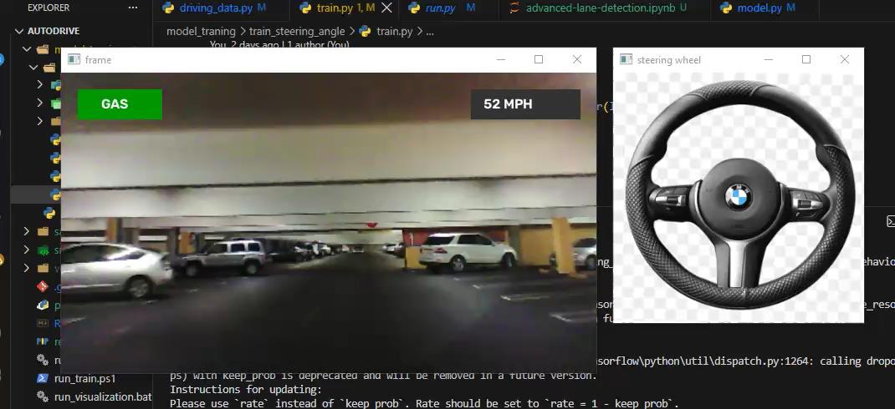
</p>

*Display demonstration from the project synopsis. Speed and pedal indicators are interface elements; this screenshot does not establish vehicle control.*

## Contents

- [System architecture](#system-architecture)
- [Datasets and preprocessing](#datasets-and-preprocessing)
- [Experimental results](#experimental-results)
- [Graphs and visual evidence](#graphs-and-visual-evidence)
- [Latency and model footprint](#latency-and-model-footprint)
- [Installation and required assets](#installation-and-required-assets)
- [Running AutoDrive](#running-autodrive)
- [Training and reproducing the research](#training-and-reproducing-the-research)
- [Repository structure](#repository-structure)
- [Limitations and next steps](#limitations-and-next-steps)
- [Research artifacts](#research-artifacts)
- [Authors and citation](#authors-and-citation)
- [References and licensing](#references-and-licensing)

## System architecture

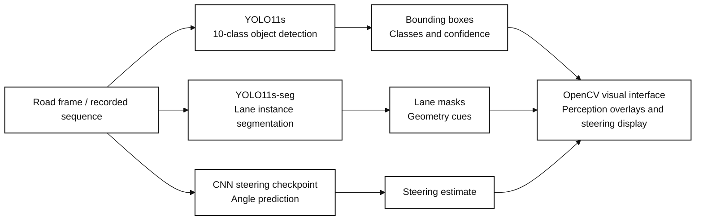

The [unified runtime](src/run.py) reads a recorded image sequence. A bounded inference coordinator runs steering and both detectors on the same clean source frame; the UI remains responsive. On CPU, the two detectors can run concurrently with one PyTorch thread each. The steering branch predicts directly from the image; lane masks and object boxes are combined in the display rather than fused into a trained driving controller.

### Steering research branch

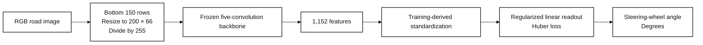

**Runtime / experiment distinction:** the main demo now loads the RGB Huber readout when its metadata and backbone hash match the restored checkpoint. It otherwise reports a fallback to the original BGR CNN. `--steering-head original` explicitly selects the original head. The historical metrics below retain their original evaluation protocols; this runtime update does not change them. The older alternative runners still use the original checkpoint head.

The inspected saved CNN has **1,595,511 parameters**. The canonical DAVE-2 reference has **252,219 parameters**; these are different graphs. See [architecture counts](docs/RESEARCH_RESULTS.md#model-architecture).

## Datasets and preprocessing

| Task | Dataset | Training | Validation | Test | Representation |
|---|---|---:|---:|---:|---|
| Object detection | COCO-10 subset | 8,080 images | 975 images | 525 images | 10-class bounding boxes |
| Lane segmentation | TuSimple-derived frames | 2,900 frames | 726 frames | No independent test split | Sparse polylines converted to narrow polygons |
| Steering | Local driving sequence | 36,324 rows | 9,082 rows | No independent drive | Image path and steering-wheel angle |

- **Object classes:** person, bicycle, car, motorcycle, bus, truck, traffic light, stop sign, dog, cat.
- **Object instances:** 56,267 train / 5,604 validation / 3,116 test.
- **Lanes:** 3,626 valid frames in total; 2,732 annotated lane instances in validation.
- **Perception input:** 640 × 640 during the reported training runs.
- **Steering research input:** RGB, bottom 150 rows, 200 × 66 pixels, divided by 255.
- **Readout fitting:** every fourth original training row gives 9,081 samples; 7,265 fit / 1,816 chronological development samples select the loss and penalty before refitting.

Full counts, model shapes, and hyperparameters are in [Detailed research results](docs/RESEARCH_RESULTS.md). Steering-data collection provenance and redistribution terms are not established in the available records.

## Experimental results

### Object detection

YOLO11s: **50 epochs**, batch **16**, **Tesla T4**, **9,416,670 parameters**, and recorded **21.4 GFLOPs**.

| Split | Images | Instances | Precision | Recall | mAP50 | mAP50–95 | mAP75 |
|---|---:|---:|---:|---:|---:|---:|---:|
| Validation | 975 | 5,604 | 0.724 | 0.621 | 0.688 | 0.486 | 0.518 |
| Held-out test | 525 | 3,116 | 0.712 | 0.614 | 0.672 | 0.471 | 0.511 |

These are detection metrics, not classification accuracy. Rounded values are shown above; the [recorded comparisons](docs/RESEARCH_RESULTS.md#recorded-comparisons) retain additional notebook precision.

### Lane instance segmentation

YOLO11s-seg: **60 epochs**, batch **16**, **Tesla T4**, **10,067,203 parameters**, and recorded **32.9 GFLOPs**.

| Metric | End of training | Standalone re-evaluation |
|---|---:|---:|
| Box mAP50 | 0.992 | 0.992 |
| Box mAP50–95 | 0.831 | 0.831 |
| Mask mAP50 | 0.877 | 0.890 |
| Mask mAP50–95 | 0.363 | 0.389 |

Thin lane masks make IoU sensitive to small offsets. Box and mask scores measure different things. These are YOLO metrics on derived annotations, **not official TuSimple leaderboard scores**; there is no independent lane test split.

### Steering-angle estimation

All four methods use the **same 9,082 validation frames**. Constants are derived from sampled training labels. Bias is the mean of `prediction − target`.

| Method | MAE ↓ | RMSE ↓ | Mean bias | R² ↑ | Pearson r ↑ | Within ±5° ↑ |
|---|---:|---:|---:|---:|---:|---:|
| Original CNN, RGB | 23.2570° | 33.6313° | +21.4106° | −0.8067 | 0.0508 | 9.82% |
| **Frozen CNN + Huber** | **14.6822°** | **26.6395°** | **+3.1230°** | **−0.1336** | **0.1682** | **31.35%** |
| Training-mean constant | 12.4793° | 25.0502° | +1.2196° | −0.0024 | Undefined | 42.57% |
| Training-median constant | 12.6900° | 25.0212° | −0.1859° | −0.0001 | Undefined | 41.62% |

The Huber readout reduces MAE by **36.9%** relative to the original RGB CNN. **Both constants remain better**, and negative R² does not establish reliable image-conditioned steering. Correlation is undefined for constant predictions.

Five squared-error penalties and four Huber configurations were compared on the inner development block. The selected threshold is **10°**, penalty **α = 100**, with **96 final L-BFGS-B iterations**. Circular block bootstrap uses 100-frame blocks, 1,000 replicates, and seed `20261021`:

| Quantity | 95% bootstrap interval |
|---|---:|
| Huber MAE | 11.631°–18.629° |
| Huber RMSE | 18.241°–35.675° |
| Paired MAE reduction vs original RGB CNN | 6.849°–10.250° |

Intervals depend on block length. Validation labels were excluded from readout fitting and selection; historical backbone exposure is unknown, and the existing validation split had been examined previously.

<details>
<summary><strong>Earlier BGR audit — 505 frames, separate evaluation</strong></summary>

This sample selects every 18th row from the original validation partition. It must not be combined with the full RGB comparison above.

| Metric | Result |
|---|---:|
| MAE | 22.9616° |
| RMSE | 33.2350° |
| Mean bias | +20.9977° |
| R² | −0.8769 |
| Pearson correlation | −0.0404 |
| Within ±5° | 9.11% |

</details>

## Graphs and visual evidence

### Perception training curves

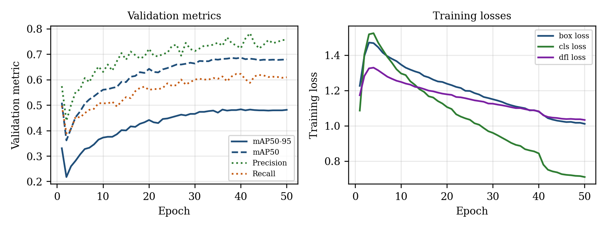

*Detection validation mAP50–95: 0.331 at epoch 1 → 0.482 at epoch 50.*

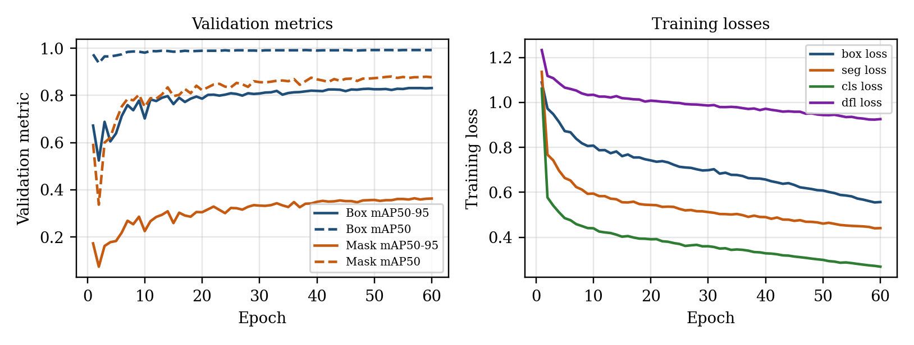

*Lane mask mAP50–95: 0.173 at epoch 1 → 0.363 at epoch 60. Standalone re-evaluation reports 0.389.*

### Steering predictions

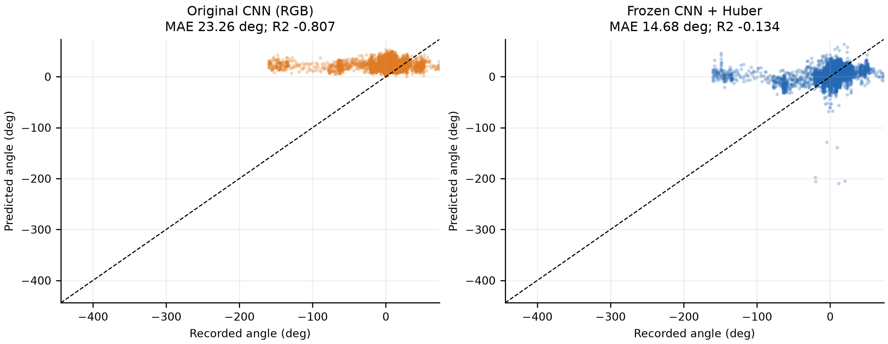

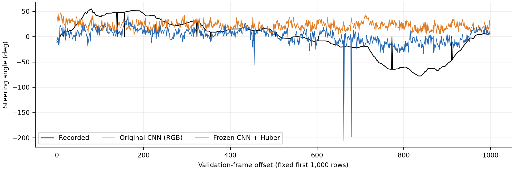

*Generated from saved, frame-aligned predictions. The scatter uses all 9,082 validation frames; the sequence shows the fixed first 1,000 frames. These plots show the remaining errors as well as improvement.*

### Qualitative predictions

<details open>
<summary><strong>Lane boxes and masks on validation frames</strong></summary>

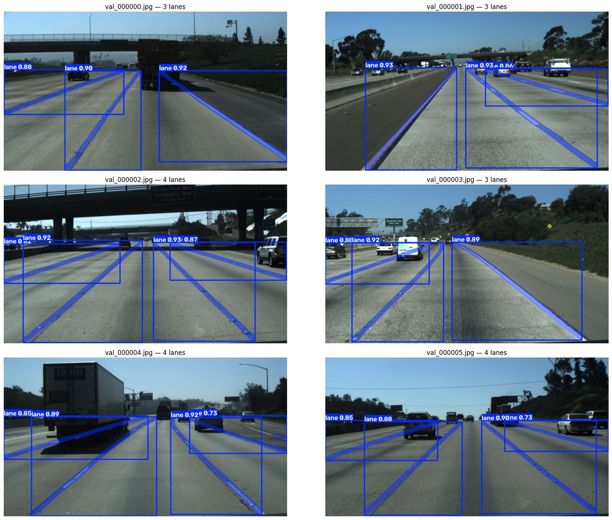

</details>

<details>
<summary><strong>Object detection on held-out test examples</strong></summary>

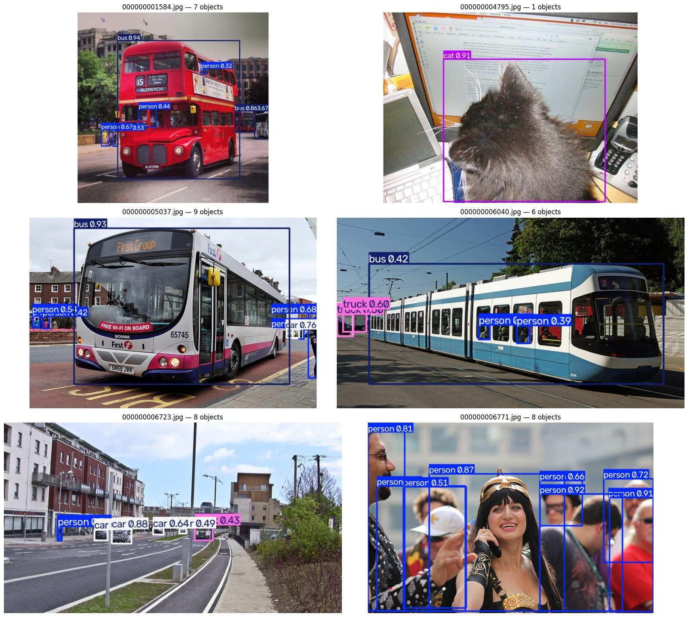

</details>

<details>
<summary><strong>Class-wise detection performance and confusion matrices</strong></summary>

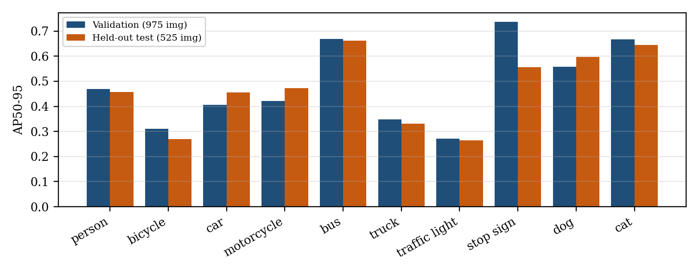

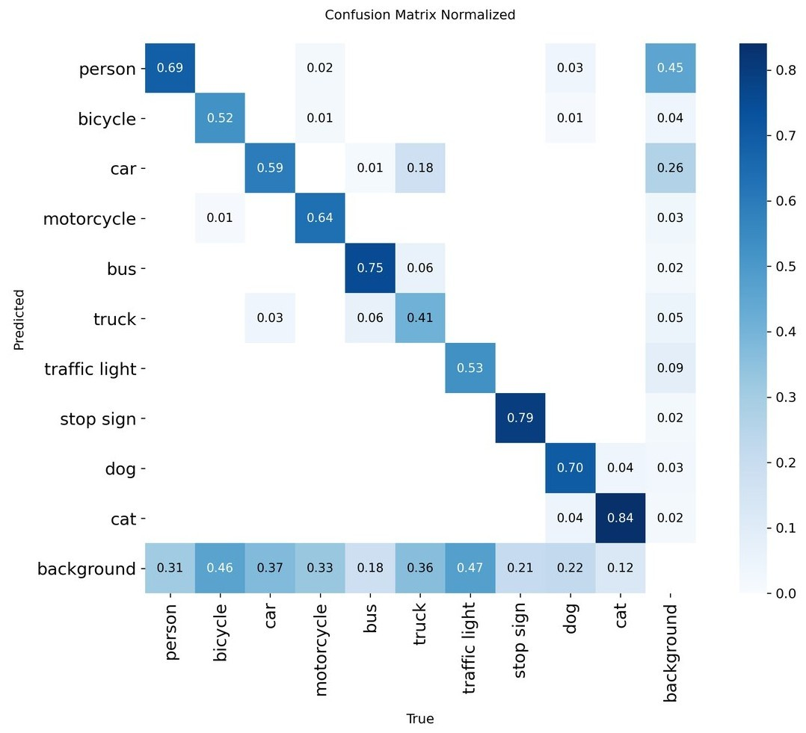

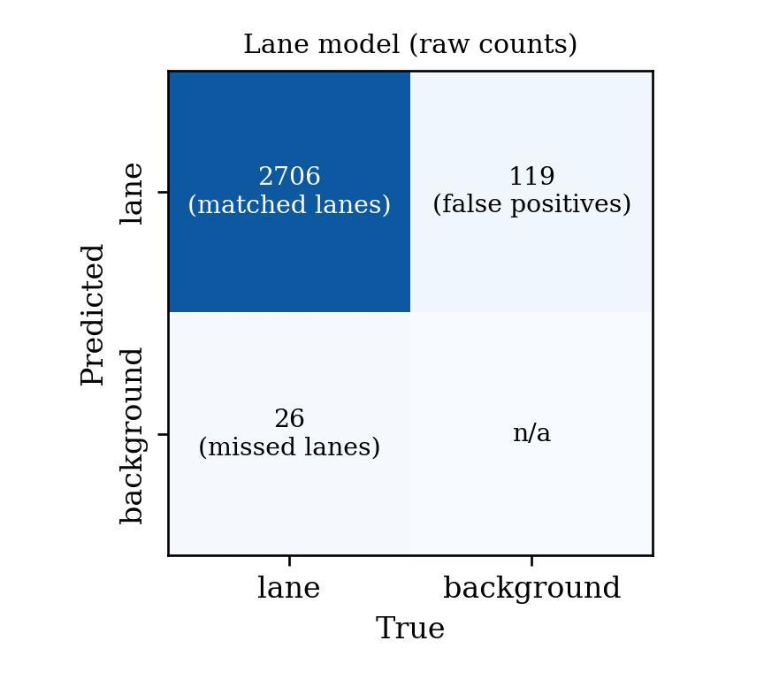

</details>

Perception figures preserve the project records; steering plots derive from the saved prediction CSV. [Figure provenance](docs/images/README.md) identifies the sources. Examples complement aggregate metrics and do not establish driving reliability.

## Latency and model footprint

Framework timings come from **separate Tesla T4 perception evaluations**.

| Measurement | Detection | Lane segmentation | Sum |
|---|---:|---:|---:|
| Batch-16 evaluation, per image | 11.1 ms | 11.8 ms | 22.9 ms |
| Single-image prediction | 17.0 ms | 14.3 ms | 31.3 ms |
| Saved weights | 19.2 MB | 20.5 MB | 39.7 MB |

The summed timings imply **32–44 FPS for the two YOLO modules only**. This is a projection, not measured full-pipeline throughput. Capture, steering, display, and control I/O are excluded. The readout experiment ran separately on a local Pentium 4415U CPU.

## Installation and required assets

[Windows + NVIDIA GPU setup and transfer guide](docs/NVIDIA_GPU_SETUP.md) includes CUDA PyTorch commands, the model-file checklist, and smooth-playback launch commands.

### 1. Create a Python environment

The package declares Python **≥3.9**. This example uses Python 3.10 and Windows PowerShell. Dependencies are currently unpinned; `requirements.txt` is not a lockfile for the recorded experiments.

```powershell
git clone https://github.com/HA2345567/Autodrive.git
cd Autodrive
py -3.10 -m venv .venv
.\.venv\Scripts\Activate.ps1
python -m pip install --upgrade pip
python -m pip install -r requirements.txt
python -m pip install -e .
```

Core libraries: TensorFlow's v1 compatibility API, OpenCV, NumPy, Pandas, Matplotlib, Keras, and Ultralytics. YOLO uses PyTorch through Ultralytics. The offline Huber experiment also requires SciPy:

```powershell
python -m pip install scipy
```

A desktop session is needed for OpenCV windows. GPU support depends on the installed framework versions, drivers, and operating system. OpenVINO is an optional CPU backend that can be installed for comparison:

```powershell
python -m pip install -r requirements-cpu.txt
```

With `--backend auto`, the main demo uses PyTorch with CUDA when available, or CPU otherwise. `--backend openvino` explicitly selects OpenVINO and exports cached FP32 models on its first use. Receipts record the source-weight hash and input size. OpenVINO was slower on the project's Pentium 4415U, so installing it does not make it the default.

### 2. Restore data and trained models

These assets are excluded by `.gitignore` and must be obtained separately. A source-only clone is insufficient to run the trained demo. No public weight download is configured here.

```text
data/
├── driving_dataset/
│   ├── data.txt                     # relative_image_path angle_in_degrees
│   └── <recorded image files>
└── sterring_wheel_image.png         # spelling used by the code
saved_models/
├── object_detection_model/
│   └── object_detection_best.pt
├── lane_detection_model/
│   └── lane_detection_best.pt
└── regression_model/
    ├── checkpoint
    ├── model.ckpt.index
    ├── model.ckpt.meta
    └── model.ckpt.data-00000-of-00001
```

Example `data.txt` format; these filenames are illustrative:

```text
frames/000001.jpg 0.0
frames/000002.jpg -4.5
```

Keep image paths relative to `data/driving_dataset/`. Preserve `sterring_wheel_image.png` unless the code is updated too. See [ARCHITECTURE.md](ARCHITECTURE.md) for the handoff map.

## Running AutoDrive

For a smooth presentation recording, use the [offline MP4 exporter](docs/OFFLINE_VIDEO_EXPORT.md). It computes each frame's predictions before encoding, so playback speed does not depend on live inference speed.

Run from the repository root after restoring the assets:

```powershell
python -m src.run
```

```powershell
# Start at a selected frame with a target playback rate
python -m src.run --start 2400 --fps 20

# Disable either overlay
python -m src.run --no-lanes
python -m src.run --no-objects

# Supply custom perception weights
python -m src.run --lane-model saved_models/lane_detection_model/lane_detection_best.pt --object-model saved_models/object_detection_model/object_detection_best.pt
```

The main runner starts in **AI mode**, showing the model prediction. The recorded steering angle and prediction error appear separately. Press **M** to switch the wheel to recorded-reference mode, or launch with `--show-actual`.

`--fps` sets the UI/target playback rate; it is not detection throughput. **Aligned playback** is the default: source image, boxes, masks, and steering prediction belong to the same frame. On a slow CPU, source playback advances at inference speed while controls keep responding. Display FPS and inference Hz are reported separately.

```powershell
# Exact frame alignment, starting on a road scene
python -m src.run --start 2400 --backend auto --playback-mode aligned

# Continuous playback with bounded short-term optical-flow tracking
python -m src.run --start 2400 --playback-mode tracked --fps 20

# Explicit original steering head, still in AI prediction mode
python -m src.run --steering-head original
```

Tracked mode hides overlays when age/frame-gap limits are exceeded or tracking is unreliable. It is not a substitute for fast fresh detections. A CPU cannot guarantee real-time inference for both full-size models.

The balanced CPU profile uses one PyTorch thread and 480-pixel lane/object inference. `--profile quality` uses 640 pixels for both; CUDA also defaults to 640. Lowering object resolution to 320 missed a distant vehicle in the local frame check, so that reduction is not the default. Thresholds remain adjustable and do not guarantee model accuracy.

| Key | Action |
|---|---|
| **M** | Switch actual / predicted steering display |
| **L** | Toggle lane overlay |
| **O** | Toggle object overlay |
| **C** | Toggle corridor visualization |
| **P** or **Space** | Pause / resume |
| **+** / **−** | Adjust target playback rate |
| **[** / **]** | Jump backward / forward by 100 frames |
| **Q** or **Esc** | Quit |

An [alternative combined runner](src/inference/run_fsd_inference.py) supports device selection and optional OpenVINO:

```powershell
python -m src.inference.run_fsd_inference --device cpu --limit 300 --use-ai-steering
```

“FSD” is a source-code label. This is a recorded-sequence visualization; pedal values are heuristic display outputs rather than validated vehicle commands.

## Training and reproducing the research

### Perception

- [COCO-10 object-detection notebook](model_training/train_object_detection/coco_object_detection_yolo11.ipynb)
- [TuSimple lane-segmentation notebook](model_training/train_lane_detection/tusimple_lane_yolo11.ipynb)

Open in Jupyter or Colab and review paths and configuration before running. Recorded notebook outputs supply the perception metrics here. Reproduction requires the same subsets, annotations, weights, and environment. Recorded training times are **2.14 h** for detection and **2.31 h** for lanes on a T4.

### Original steering CNN

```powershell
python -m model_training.train_steering_angle.train
```

The script defines 30 epochs, batch 100, Adam learning rate `1e-4`, and L2 coefficient `0.001`. It writes to `saved_models/steering_angle/`; the runtime's standard handoff location is `saved_models/regression_model/`. Restore the intended checkpoint there before inference. This configuration alone does not establish the available checkpoint's complete historical training exposure.

### Frozen-feature steering experiment

With the original checkpoint and driving dataset restored:

```powershell
# Extract RGB features and fit squared-error candidates
python research_paper/train_steering_readout.py

# Compare Huber candidates within the training partition
python research_paper/train_robust_steering_readout.py

# Summarize saved predictions, bootstrap intervals, and plots
python research_paper/summarize_steering_experiment.py
```

These commands fit models and regenerate `output/steering_audit/`; they are not needed to read the results. Preserve recorded evidence before rerunning. The feature cache checks checkpoint hash and selected row IDs, but does not fully fingerprint image contents; remove stale cached features when data change.

| Evidence | Purpose |
|---|---|
| [Experiment report](output/steering_audit/STEERING_EXPERIMENT.md) | Protocol, results, diagnosis, uncertainty |
| [Selected-readout audit](output/steering_audit/improved_readout_audit.json) | Candidate search, configuration, optimizer status |
| [Comparison summary](output/steering_audit/comparison_summary.json) | Baselines, bootstrap intervals, label audit |
| [Frame-level predictions](output/steering_audit/improved_validation_predictions.csv) | Image, target, original and selected predictions |
| [Readout plan](research_paper/steering_readout_plan.json) | Training-only selection protocol |
| [Perception comparisons](research_paper/recorded_comparisons.json) | Notebook hashes, cells, epoch records |

The readout `.npz`, feature cache, images, and original weights are needed for executable reproduction. The readout alone is not a complete steering model.

## Repository structure

```text
Autodrive/
├── README.md
├── ARCHITECTURE.md                  # Runtime and asset handoff map
├── requirements.txt
├── setup.py
├── src/
│   ├── run.py                       # Main recorded-sequence interface
│   ├── models/model.py              # TensorFlow steering graph
│   └── inference/                   # Perception and display runners
├── model_training/
│   ├── train_object_detection/      # COCO-10 notebook
│   ├── train_lane_detection/        # TuSimple notebook
│   └── train_steering_angle/        # Loader and original trainer
├── research_paper/                  # Manuscript and experiment scripts
├── docs/
│   ├── RESEARCH_RESULTS.md          # Detailed metric tables
│   └── images/                      # README figures and provenance
├── output/
│   ├── pdf/                         # Research manuscripts
│   ├── docx/                        # Editable manuscripts
│   ├── presentation/                # Final PowerPoint and PDF
│   └── steering_audit/              # Saved experiment evidence
├── tests/                          # Existing component/integration checks
├── data/                           # Local assets; excluded from Git
└── saved_models/                   # Local weights; excluded from Git
```

## Limitations and next steps

1. **Steering remains unresolved.** The readout improves on the original CNN but trails constants. Reliable image-conditioned steering is not established.
2. **Limited evaluation scope.** Steering uses an existing ordered internal split; lanes lack an independent test split. Historical backbone exposure and steering-data provenance are unknown.
3. **Derived lane labels.** Narrow polygons from sparse polylines introduce sensitivity to mask width and alignment. Official TuSimple evaluation remains future work.
4. **Historical perception records.** Saved notebook outputs and figures support these numbers; an independent full evaluator rerun is not claimed by this documentation update.
5. **Display is not closed-loop control.** Actual dataset steering can be displayed and pedals are heuristic. No vehicle-actuation result or autonomy level is established.
6. **Partial timing.** Full-pipeline latency, sustained FPS, and steering runtime need a shared hardware benchmark.
7. **Reproducibility requirements.** Weights and data are not bundled, dependencies are unpinned, and data changes require cache invalidation.

Priorities are independent-drive data, turn-balanced evaluation, temporal steering models, official lane metrics, controlled simulator experiments, and complete runtime timing. These are future work, not completed claims.

## Research artifacts

| Artifact | Link |
|---|---|
| Latest manuscript, PDF | [Research paper](output/pdf/AutoDrive_Research_Paper_Reference_Style.pdf) |
| Editable manuscript | [Word document](output/docx/AutoDrive_Research_Paper_Latest.docx) |
| Manuscript with PDF-matched layout | [Word document](output/docx/AutoDrive_Research_Paper_PDF_Layout.docx) |
| Editable presentation | [PowerPoint with speaker notes and embedded demo](output/presentation/AutoDrive_Final_Presentation_With_Smooth_Video.pptx) |
| Combined demonstration | [20-second video with smooth AI steering](output/video/AutoDrive_20s_Demo_Smooth_Steering.mp4) |
| Presentation PDF | [Slide PDF](output/presentation/AutoDrive_Final_Presentation_Ready.pdf) |
| Full tables | [Research results](docs/RESEARCH_RESULTS.md) |
| Implementation and proof of work | [HA2345567/Autodrive](https://github.com/HA2345567/Autodrive) |

Include the linked documentation and output artifacts when publishing this repository snapshot.

## Authors and citation

**AutoDrive Research Team**

| Author | Email |
|---|---|
| Harsh Bhardwaj | [bhardwajharsh0312@gmail.com](mailto:bhardwajharsh0312@gmail.com) |
| Shrishti Singh | [shrisht2723@gmail.com](mailto:shrisht2723@gmail.com) |
| Rajat Kandpal | [rajatkandpal12@gmail.com](mailto:rajatkandpal12@gmail.com) |

Cite the repository and the specific commit or release used. This is a repository citation, not a claim of journal publication:

```bibtex
@misc{bhardwaj_autodrive_2026,
  author       = {Bhardwaj, Harsh and Singh, Shrishti and Kandpal, Rajat},
  title        = {AutoDrive: Perception and Steering Research Prototype},
  year         = {2026},
  howpublished = {Source code repository and research artifacts},
  url          = {https://github.com/HA2345567/Autodrive}
}
```

## References and licensing

Core references also listed in the manuscript:

1. Bojarski et al. *End to End Learning for Self-Driving Cars*. 2016. [arXiv:1604.07316](https://arxiv.org/abs/1604.07316).
2. Ultralytics. *YOLO11 implementation*. [Source repository](https://github.com/ultralytics/ultralytics).
3. TuSimple. *Lane Detection Benchmark*. [Dataset and evaluation code](https://github.com/TuSimple/tusimple-benchmark).
4. Lin et al. *Microsoft COCO: Common Objects in Context*. ECCV, 2014. [arXiv:1405.0312](https://arxiv.org/abs/1405.0312).
5. Neven et al. *Towards End-to-End Lane Detection: an Instance Segmentation Approach*. 2018. [arXiv:1802.05591](https://arxiv.org/abs/1802.05591).

**Licensing:** this snapshot has no standalone `LICENSE` file. Although `setup.py` contains an MIT classifier, that metadata alone does not supply a license text. Clarify licensing with the authors before reuse or redistribution. Third-party datasets, dependencies, and source imagery retain their respective terms.

---

<div align="center">

**AutoDrive Research Team**<br>
[Explore the code](src/) · [Read the results](docs/RESEARCH_RESULTS.md) · [View the paper](output/pdf/AutoDrive_Research_Paper_Reference_Style.pdf)

</div>
